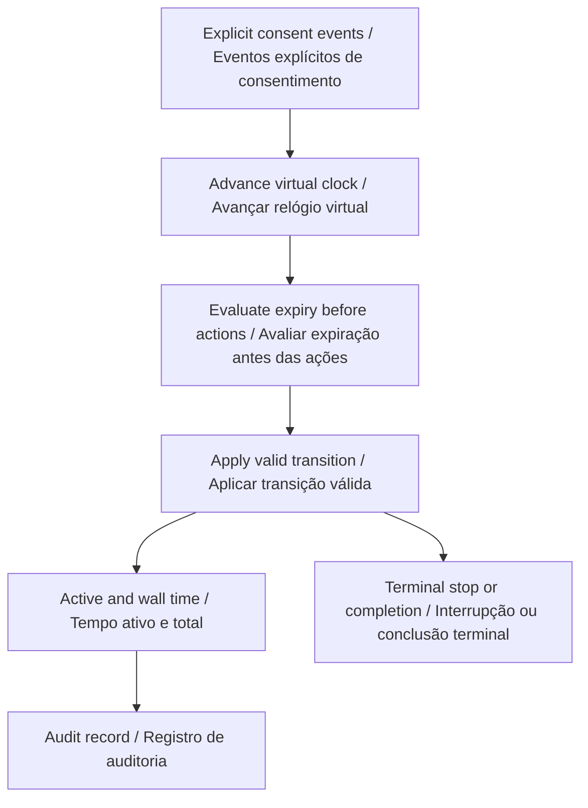
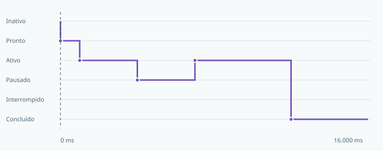

# Évia Session Orchestrator

**Rehearse consent, pauses and recovery before an interaction begins.**  
**Ensaie consentimento, pausas e retomadas antes de iniciar uma interação.**

[](https://github.com/galafis/evia-session-orchestrator/actions/workflows/ci.yml) · **v0.1.0** · **28 automated tests / testes automatizados** · **MIT**

[English](#english) · [Português](#portugues) · [Live workbench · Demonstração](https://galafis.github.io/evia-session-orchestrator/) · [Examples · Exemplos](#examples)

<!-- domain-workflow:start -->

## Domain workflow · Fluxo do domínio



<!-- domain-workflow:end -->

<a id="english"></a>

## English

A deterministic session-rehearsal engine for explicit consent, participant-controlled pauses, operator stops and bounded activity time. It helps authors examine interaction sequences before attaching any physical device.

This is independently implemented public companion work for Évia. It has no dependency on the Évia core and uses synthetic fixtures.

### What works today

- Six inspectable states: idle, ready, active, paused, stopped and completed.
- Separate clocks for active activity, consent expiry and total session duration.
- A transition record for every accepted or rejected action, including automatic expiry events.
- A virtual-time cursor, bilingual explanations and reproducible JSON exports.


### Run it locally

Use **Node.js 22 or newer**. There are no third-party runtime packages to install.

```sh
git clone https://github.com/galafis/evia-session-orchestrator.git
cd evia-session-orchestrator
npm test
npm start
```

Open **http://127.0.0.1:4173**. The browser includes an English/Portuguese switch. Choose an example, adjust the primary assumption, and select **Update**. Expand **Edit all scenario fields** for the complete JSON editor. Invalid imports leave the last valid result visible with an explicit error message. Export both the scenario and report to preserve the experiment.

For headless use:

```sh
node scripts/analyze.mjs examples/nominal.json report.json
npm run examples
npm run test:coverage
```

The command-line exit codes are **0** for completed analysis or review notes, **2** for a valid scenario that needs review, and **1** for invalid input or invocation. A review-required result is still written to the requested report file.

### An experiment you can reproduce

The nominal session grants consent at 0 ms, starts at 1,000 ms, pauses at 4,000 ms and resumes at 7,000 ms. It completes at 12,000 ms after exactly 8,000 ms of active time. Changing the consent window to 6,000 ms stops it while paused, with 3,000 ms of active time.

### How the result is calculated

- Consent prepares a session; start begins activity. Consent is an explicit supplied event and is never inferred from silence, presence or a sensor.
- Pause stops the active clock, while consent and session wall-clock deadlines continue. Resume requires an unexpired grant.
- Automatic deadlines are evaluated before actions at the same timestamp. Consent expiry has priority over the session limit, which has priority over activity completion.

```text
active time = sum of intervals whose state is active / tempo ativo = soma dos intervalos em que o estado é ativo
```

The [architecture guide](docs/ARCHITECTURE.md) explains every rule and boundary case. The [data contract](docs/DATA_CONTRACT.md) documents fields, units, limits and the report envelope. [Research scope](docs/RESEARCH_SCOPE.md) separates implemented behavior from future platform work.

### What the result does not establish

This is a software state model, not a consent-management service or a clinical protocol. It does not identify participants, interpret behavior, schedule real actuators or guarantee that a session is appropriate. Time limits are scenario choices, not validated human-interaction thresholds.

### Where this fits

Use a practitioner-reviewed activity plan from Inclusive Session Studio to author explicit events. Review stop and withdrawal sequences with adult collaborators using the software alone. Any future device adapter must preserve these event semantics and produce separate physical test evidence.

Related public project: [inclusive-session-studio](https://github.com/galafis/inclusive-session-studio). Each repository is independently runnable; a link does not imply a live integration. See [integration notes](docs/INTEGRATION.md) for the exact supported exchange, where present.

[Back to language navigation](#english)

---

<a id="portugues"></a>

## Português

Um mecanismo determinístico de ensaio de sessões com consentimento explícito, pausas controladas pelo participante, interrupção pelo operador e tempo de atividade delimitado. Permite examinar sequências de interação antes de conectar qualquer dispositivo físico.

Este é um trabalho público complementar à Évia, implementado de forma independente. Não depende do núcleo da Évia e utiliza exemplos sintéticos.

### O que já funciona

- Seis estados inspecionáveis: inativo, pronto, ativo, pausado, interrompido e concluído.
- Relógios separados para atividade efetiva, expiração do consentimento e duração total da sessão.
- Registro de cada ação aceita ou rejeitada, incluindo eventos automáticos de expiração.
- Cursor de tempo virtual, explicações bilíngues e exportações JSON reproduzíveis.



### Executar localmente

Use **Node.js 22 ou mais recente**. Não há pacotes externos de execução para instalar.

```sh
git clone https://github.com/galafis/evia-session-orchestrator.git
cd evia-session-orchestrator
npm test
npm start
```

Abra **http://127.0.0.1:4173**. O navegador oferece alternância entre português e inglês. Escolha um exemplo, ajuste a hipótese principal e selecione **Atualizar**. Expanda **Editar todos os campos do cenário** para acessar o editor JSON completo. Importações inválidas mantêm o último resultado válido visível com mensagem explícita de erro. Exporte o cenário e o relatório para preservar o experimento.

Para usar sem interface gráfica:

```sh
node scripts/analyze.mjs examples/nominal.json report.json
npm run examples
npm run test:coverage
```

Os códigos de saída são **0** para análise concluída ou com notas, **2** para cenário válido que exige revisão e **1** para entrada ou chamada inválida. Resultados que exigem revisão também são gravados no arquivo de relatório solicitado.

### Um experimento reproduzível

A sessão nominal concede consentimento em 0 ms, começa em 1.000 ms, pausa em 4.000 ms e retoma em 7.000 ms. Termina em 12.000 ms após exatamente 8.000 ms de tempo ativo. Ao alterar a janela de consentimento para 6.000 ms, ela é interrompida durante a pausa, com 3.000 ms de tempo ativo.

### Como o resultado é calculado

- O consentimento prepara a sessão; o início ativa a atividade. Consentimento é um evento informado explicitamente e nunca é inferido de silêncio, presença ou sensor.
- A pausa interrompe a contagem de tempo ativo, enquanto os prazos de consentimento e duração total continuam. A retomada exige uma autorização ainda válida.
- Os prazos automáticos são avaliados antes das ações no mesmo instante. A expiração do consentimento tem prioridade sobre o limite da sessão, que tem prioridade sobre a conclusão da atividade.

```text
active time = sum of intervals whose state is active / tempo ativo = soma dos intervalos em que o estado é ativo
```

O [guia de arquitetura](docs/ARCHITECTURE.md) explica todas as regras e os casos limite. O [contrato de dados](docs/DATA_CONTRACT.md) documenta campos, unidades, limites e o formato do relatório. O [escopo de pesquisa](docs/RESEARCH_SCOPE.md) separa funcionalidades implementadas de futuras etapas com a plataforma.

### O que o resultado não comprova

Este é um modelo de estados em software, não um serviço de gestão de consentimento nem um protocolo clínico. Não identifica participantes, interpreta comportamentos, programa atuadores reais ou garante a adequação de uma sessão. Os limites de tempo são escolhas do cenário, não parâmetros de interação humana validados.

### Como este projeto se conecta ao portfólio

Use um plano de atividades do Inclusive Session Studio, revisado por profissionais, para definir eventos explícitos. Revise as sequências de parada e retirada com colaboradores adultos usando apenas o software. Um futuro adaptador de dispositivo deve preservar a semântica desses eventos e produzir evidências próprias de testes físicos.

Projeto público relacionado: [inclusive-session-studio](https://github.com/galafis/inclusive-session-studio). Cada repositório funciona independentemente; um link não implica integração em tempo real. Consulte as [notas de integração](docs/INTEGRATION.md) para conhecer as trocas efetivamente suportadas, quando existentes.

---

<a id="examples"></a>

## Reproducible examples · Exemplos reproduzíveis

| Example · Exemplo                         | Result · Resultado | Reproduce · Reproduzir                                                                                      |
| ----------------------------------------- | ------------------ | ----------------------------------------------------------------------------------------------------------- |
| Pause and resume<br>Pausa e retomada      | `complete`         | [Input · Entrada](examples/nominal.json) · [Report · Relatório](examples/nominal.report.json)               |
| Consent expires<br>Consentimento expirado | `review-notes`     | [Input · Entrada](examples/consent-expiry.json) · [Report · Relatório](examples/consent-expiry.report.json) |
| Operator stop<br>Parada solicitada        | `review-notes`     | [Input · Entrada](examples/operator-stop.json) · [Report · Relatório](examples/operator-stop.report.json)   |

## Project guide · Guia do projeto

| Document · Documento                                          | Content · Conteúdo                                                                    |
| ------------------------------------------------------------- | ------------------------------------------------------------------------------------- |
| [Architecture · Arquitetura](docs/ARCHITECTURE.md)            | Domain rules, algorithms and boundaries · Regras, algoritmos e limites                |
| [Data contract · Contrato de dados](docs/DATA_CONTRACT.md)    | Fields, units and JSON format · Campos, unidades e formato JSON                       |
| [Schema](schemas/scenario.schema.json)                        | Structural JSON Schema · Esquema estrutural JSON                                      |
| [Validation · Validação](docs/VALIDATION.md)                  | Behavioral tests and review protocol · Testes de comportamento e protocolo de revisão |
| [Research scope · Escopo de pesquisa](docs/RESEARCH_SCOPE.md) | Platform relationship and next steps · Relação com a plataforma e próximas etapas     |
| [Integration · Integração](docs/INTEGRATION.md)               | Public artifact exchange · Troca de artefatos públicos                                |
| [Contributing · Contribuições](CONTRIBUTING.md)               | Development and review · Desenvolvimento e revisão                                    |
| [Security · Segurança](SECURITY.md)                           | Privacy and responsible reports · Privacidade e relatos responsáveis                  |
| [Changelog · Histórico](CHANGELOG.md)                         | Versioned changes · Alterações por versão                                             |

## Maintainer · Responsável

**Gabriel Demetrios Lafis** · Brazil / Brasil  
**[gabrieldemetrioslafis@usp.br](mailto:gabrieldemetrioslafis@usp.br)** · [GitHub](https://github.com/galafis)

Independent work; institutional contact does not imply institutional or vendor endorsement.  
Trabalho independente; o contato institucional não implica endosso de instituição ou fabricante.

[Worked examples with expected metrics · Exemplos comentados com métricas esperadas](docs/EXPERIMENTS.md)
